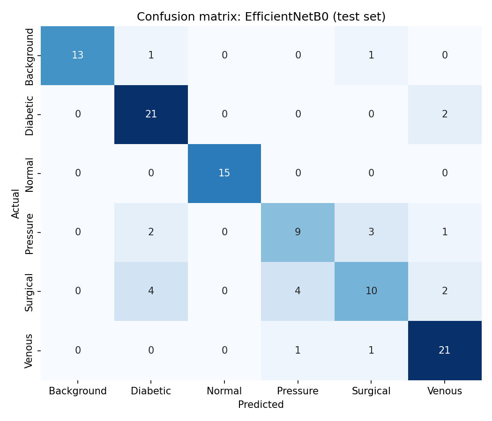

# WoundNet — Wound Image Classification

Comparing MLP, CNN and transfer-learning models (Keras / TensorFlow) for **6-class wound image classification**, varying the number of hidden layers and training epochs to find the best model.

**Best model: EfficientNetB0 (frozen, no extra hidden layer) — 80.2% test accuracy, 0.800 macro F1.**

---

## Dataset

- **AZH Wound dataset**: 738 images, 6 classes: Background, Diabetic, Normal, Pressure, Surgical, Venous
- Source: [uwm-bigdata/wound-classification-using-images-and-locations](https://github.com/uwm-bigdata/wound-classification-using-images-and-locations)
- The images are **not** included in this repo. Download them from the source above.

One fixed **stratified split (70 / 15 / 15, seed 42)**, used by every model:

| Split | Images |
|---|---|
| Train | 516 |
| Validation | 111 |
| Test | 111 |

Using one fixed split for all models ensures that no test image is ever seen during training or model selection, and that every model is compared on exactly the same images.

---

## Experiment setup

- Same optimizer, batch size (32), image size (224×224) and 30 epochs for every model
- Validation accuracy recorded at epochs **10, 20 and 30**
- **Model selection is done on validation accuracy only.** The test set is used once, for the final numbers.
- Trained on Google Colab (T4 GPU)

### Models compared (12 runs)

| Family | Variants |
|---|---|
| MLP | 1, 2, 3 hidden layers |
| CNN (from scratch, BatchNorm) | 2, 3, 4 conv blocks |
| MobileNetV2 (ImageNet, frozen) | 0, 1, 2 hidden layers + a fine-tuned version |
| EfficientNetB0 (ImageNet, frozen) | 0, 1 hidden layers |

---

## Results

| Model | Params | Val acc @10 | Val acc @20 | Val acc @30 | Test acc | Macro F1 |
|---|---:|---:|---:|---:|---:|---:|
| MLP_1hidden | 6,295,046 | 0.360 | 0.387 | 0.378 | 0.378 | 0.288 |
| MLP_2hidden | 6,424,838 | 0.315 | 0.333 | 0.324 | 0.306 | 0.199 |
| MLP_3hidden | 6,456,966 | 0.306 | 0.243 | 0.216 | 0.207 | 0.057 |
| CNN_2blocks | 28,870 | 0.468 | 0.604 | 0.640 | 0.514 | 0.493 |
| CNN_3blocks | 111,430 | 0.468 | 0.622 | 0.613 | 0.577 | 0.579 |
| CNN_4blocks | 424,006 | 0.577 | 0.550 | 0.550 | 0.541 | 0.535 |
| MobileNetV2_0hidden | 2,265,670 | 0.784 | 0.802 | 0.793 | 0.703 | 0.694 |
| MobileNetV2_1hidden | 2,422,726 | 0.775 | 0.802 | 0.775 | 0.703 | 0.708 |
| MobileNetV2_2hidden | 2,619,590 | 0.784 | 0.802 | 0.784 | 0.748 | 0.752 |
| MobileNetV2_finetuned | 2,265,670 | 0.793 | 0.793 | 0.793 | 0.748 | 0.748 |
| **EfficientNetB0_0hidden** | **4,057,257** | **0.793** | **0.784** | **0.802** | **0.802** | **0.800** |
| EfficientNetB0_1hidden | 4,214,313 | 0.766 | 0.766 | 0.721 | 0.766 | 0.773 |

Full table: [`figures/results_table.csv`](figures/results_table.csv)

### Best model per family (chosen on validation)

| Family | Best variant | Test accuracy |
|---|---|---:|
| MLP | 1 hidden layer | 37.8% |
| CNN | 2 blocks (only 29K parameters) | 51.4% |
| MobileNetV2 | 0 hidden / fine-tuned | 70–75% |
| **EfficientNetB0** | **0 hidden layers** | **80.2%** |

### Per-class performance (EfficientNetB0)

- **Normal**: 100% recall
- **Pressure**: 60% recall
- **Surgical**: 50% recall, the weakest class



---

## Key findings

1. **Transfer learning wins clearly.** Every pretrained model (70–80%) beats every model trained from scratch (≤58%).
2. **CNNs are far more parameter-efficient than MLPs.** CNN_2blocks has about 218× fewer parameters than MLP_1hidden (28,870 vs 6.3M) and still scores 14 points higher. Flattening an image into an MLP throws away spatial structure.
3. **More hidden layers did not help on 516 training images.** MLP accuracy falls as depth increases (37.8% → 30.6% → 20.7%), and adding a hidden layer to EfficientNetB0 lowered validation accuracy.
4. **More epochs mainly help models trained from scratch.** Pretrained models are close to their best by epoch 10; CNNs keep improving up to epoch 20–30.

## Limitations

- The test set has only 111 images, so test accuracy carries roughly ±4 percentage points of uncertainty. Small differences between models should not be over-read.
- Each configuration was trained once (single seed).
- Surgical and Pressure wounds are often confused with other classes. More data or targeted augmentation would be the next step.
- Test-time augmentation was tried but did not improve results, so it was not adopted.

---

## Repository structure

```
├── WoundNet_Model_Comparison.ipynb   # full experiment notebook
├── app.py                            # Gradio demo
├── requirements.txt
├── models/
│   └── EfficientNetB0_0hidden.keras  # best trained model
└── figures/                          # charts + results_table.csv
```

All 12 trained models are available under [Releases](https://github.com/Fantastic99-1/Wound-classification/releases).

## How to run

**Notebook:** open `WoundNet_Model_Comparison.ipynb` in Google Colab, select a T4 GPU runtime, upload the dataset zip to Google Drive, and run the cells in order.

**Demo:**

```bash
git clone https://github.com/Fantastic99-1/Wound-classification.git
cd Wound-classification
pip install -r requirements.txt
python app.py
```

Then open the local link Gradio prints and upload a wound image.

---

*Built as a college machine learning assignment. Not a medical device. Not for clinical use.*
